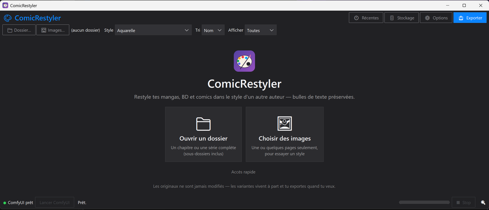

# 💥 ComicRestyler

**Re-style manga, comic and BD pages with Stable Diffusion — while keeping the speech bubbles intact.**

ComicRestyler drives a local [ComfyUI](https://github.com/comfyanonymous/ComfyUI) (SDXL img2img + ControlNet) to redraw full comic pages in another art style. Text balloons are detected automatically, protected during generation, and re-composited from the original — so the page stays readable.



## Features

- **Bubble-safe restyling** — speech balloons are detected ([comic-text-detector](https://github.com/zyddnys/manga-image-translator), ONNX, GPL-3.0, downloaded on first use), masked out, and pasted back pixel-perfect from the original page.
- **Styles are plain JSON** — ships with generic presets (B&W manga with screentones, ligne claire, inked US comics, watercolor, **B&W → color colorization**). Add your own prompts and LoRAs in a local `styles.json`.
- **Per-page variants**: generate several candidates, compare, pick, export (JPEG/PNG/WebP, quality setting).
- **Character-aware prompts**: an optional WD tagger pass (ONNX, CPU) injects `1boy`/`1girl` and traits per page.
- **ControlNet union** keeps layout, panels and poses locked while the rendering style changes.
- 19 UI themes, thumbnail browser for whole chapters, ComfyUI launcher + watchdog.

## Requirements

- Windows, Python 3.10+ (`pillow`, `opencv-python`, `numpy`, `onnxruntime`, `ttkbootstrap`, `pywin32`)
- A working **ComfyUI** with an SDXL checkpoint and `controlnet-union-sdxl-promax`

## Quick start

```bash
git clone https://github.com/hypedigger/ComicRestyler.git
cd ComicRestyler
pip install pillow opencv-python numpy onnxruntime ttkbootstrap pywin32
```

1. Edit `launch_config.json` so `python` and `comfy_main` point at your ComfyUI install.
2. `python app.py` → pick a folder of pages → pick a style → generate.
3. Optional: `python install_shortcuts.py` for Start Menu/desktop shortcuts.

Your `styles.json` and `app_settings.json` stay local; the repo only ships `styles.example.json`.

## Legal note

This tool is for **your own pages and lawful personal use**. Comic pages you process remain the property of their authors and publishers — don't redistribute restyled copyrighted pages.

## Notes

- UI is currently in French; contributions welcome.
- Bubble detector model: [zyddnys/manga-image-translator](https://github.com/zyddnys/manga-image-translator) (GPL-3.0). Tagger: [SmilingWolf WD ViT](https://huggingface.co/SmilingWolf) (Apache-2.0). Both downloaded at runtime, never redistributed here.

## Support

If ComicRestyler made something cool:

[](https://ko-fi.com/hypedigger)

## License

[MIT](LICENSE)
